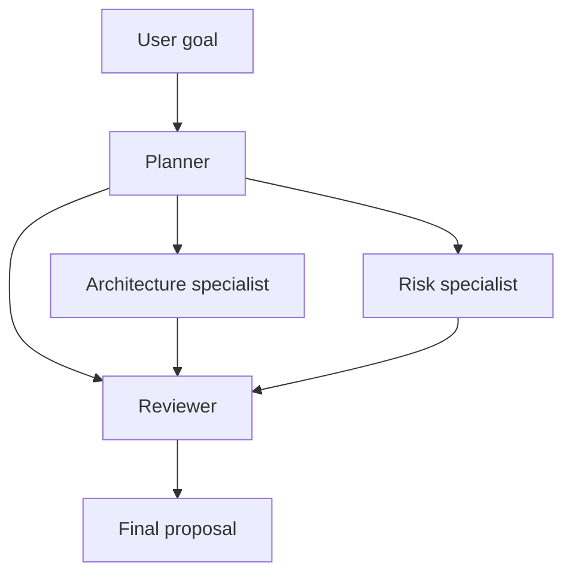

# Agent Orchestra

A small multi-agent orchestration system built in Python. Give it a project goal: a planner defines requirements, architecture and risk specialists work concurrently, and a reviewer combines their outputs into a proposal.

This is portfolio project 1 of 3: multi-agent orchestration, followed by a guarded RAG system, then an AI agent with audit logs. Only project 1 is implemented here.

## Run in one minute

Requires Python 3.11 or newer. No third-party Python packages are needed.

```bash
python -m orchestra "Plan a low-cost motor vibration monitoring system"
```

The default **demo mode uses clearly labelled, fixed fixtures**. It exercises the real scheduler without downloading a model; it does not perform AI reasoning.

## Run with a real local model

Install [Ollama](https://ollama.com), start its local server, and download a model:

```bash
ollama pull llama3.2
python -m orchestra "Plan a low-cost motor vibration monitoring system" --provider ollama --model llama3.2 --timeout 120
```

If Ollama is not running, start it with `ollama serve` in another terminal. Model downloads need internet access and local inference needs sufficient RAM. Choose a model your computer can run; use `--concurrency 1` for constrained machines. Scheduler concurrency does not guarantee concurrent inference on the model server.

Each agent makes a separate model call with its own role and dependency context. The same model powers all roles by default. The local adapter uses Ollama's [chat endpoint](https://github.com/ollama/ollama/blob/main/docs/api.md), with streaming disabled.

## Flow



The workflow is defined in Python, not generated by the model. The planner supplies requirements; the engine controls scheduling and dependencies. This makes execution predictable and easy to inspect.

## What the engine handles

- Validates unique agent names, missing dependencies and cycles before execution.
- Starts ready agents concurrently, up to a configurable limit.
- Passes only direct dependency outputs to each agent.
- Applies a timeout per attempt; retries failed calls a bounded number of times.
- Skips downstream work when a dependency fails; independent branches continue.
- Saves statuses, attempts and execution events in `runs/<run-id>/run.json`.
- Writes the reviewer output to `report.md` and exits nonzero when the final stage fails.

```bash
python -m orchestra "Plan a study assistant" --concurrency 2 --retries 1 --timeout 120
python -m unittest discover -s tests -v
```

`--retries 1` allows two total attempts per agent. A timeout kills the HTTP worker process; the Ollama server may still finish computation already started. All provider failures are currently retried, including errors that may be permanent. Error records contain exception types, not raw server responses.

## Read the source in this order

1. `orchestra/__main__.py`: roles, workflow and command-line interface.
2. `orchestra/engine.py`: dependency validation, concurrency and failure handling.
3. `orchestra/providers.py`: deterministic demo and real model adapters.
4. `tests/test_engine.py`: behavior under concurrency, retries and failures.

To add an agent, create an `Agent(name, instruction, dependencies)` in `team()`. To change model providers, implement the asynchronous `generate(agent, goal, context)` interface. Provider implementations must cooperate with cancellation.

## What this version does not claim

This is an inspectable MVP, not a production orchestration service. It has no web browsing, code execution tools, model-generated routing, durable resume, distributed queue, authentication, or security guardrails. The reviewer checks outputs using a model; it does not independently verify facts. Execution traces are ordinary local files, not tamper-proof audit logs. Prompts and outputs may contain sensitive information: generated runs are ignored by Git.

## Verification

Automated tests exercise the engine without a model. A successful demo confirms workflow mechanics, not model quality. Validate live model responses separately before presenting quality claims. A useful next evaluation: run ten project briefs, score completeness and contradictions, and compare this team with a single model call using the same model.

## Continuous integration

GitHub Actions runs the offline tests on pushes and pull requests across Python 3.11, 3.12 and 3.13. No API secrets are required. Live model quality must be evaluated separately.
